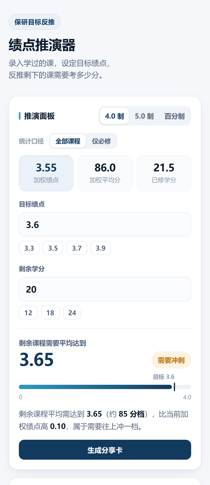

# 绩点推演器 · 保研目标反推

> 录入学过的课，设定目标绩点，反推剩下的课需要考多少分。

多数绩点工具只回答「我已经考成什么样」。这个工具反过来问：**要达到目标，剩下的课要考多少分** —— 并直接判断这个目标是否现实。

作者：Steven Xiao · 双击 `index.html` 即可运行，无需安装、无需联网。



---

## 功能

| 模块 | 说明 |
|---|---|
| 现状统计 | 加权绩点、加权平均分、已修学分实时计算 |
| 统计口径 | 全部课程 / 仅必修，一套数据两种算法，对应不同保研认定规则 |
| 目标反推 | 输入目标绩点与剩余学分，算出剩余课程需要的平均水平 |
| 可行性判断 | 四态提示：待录入 / 可以达成 / 需要冲刺 / 超出可达范围 |
| 满绩上限 | 目标不现实时，直接给出「即便全满绩也只能到多少」，避免无效努力 |
| 情景模拟 | 拖动滑块预演不同发挥下的最终绩点，并与目标做差值对比 |
| 成绩录入 | 分数与等级混输：`88`、`86.5`、`优秀`、`良好`、`A`、`B+` 均可，等级按中值估算并标注 ≈ |
| 课程类型 | 必修 / 选修 / 通识 / 不计入绩点，通过制课程可排除在加权之外 |
| 批量导入 | 一行一门，格式 `课程名 学分 成绩 [类型]`，格式不符的行自动跳过并提示 |
| 三种制式 | 4.0 制（分档）、5.0 制（线性）、百分制，切换时目标值按比例换算 |
| 数据备份 | 导出 / 导入 JSON、导出 CSV；数据结构带版本号，旧数据自动迁移 |
| 误操作保护 | 删除与清空均可在提示条上撤销，也支持 `Ctrl/Cmd + Z` |
| 数据校验 | 缺学分、成绩无法识别时即时标红，并在面板汇总提示 |
| 分享卡 | Canvas 生成 1080×1350 竖版图，弹窗预览，可下载或长按保存 |
| 本地存储 | 数据写入 localStorage，刷新不丢，不上传任何服务器 |

---

## 快速开始

**方式一：直接打开**（推荐，零依赖）

双击 `index.html`，或拖进浏览器。项目不含 ES Module、不含 `fetch`，`file://` 协议下所有功能均可用。

**方式二：本地服务器**

```bash
python -m http.server 4173
# 打开 http://localhost:4173
```

---

## 项目结构

```
gpa-planner/
├── index.html                      # 应用本体（单文件：样式 + 结构 + 逻辑）
├── screenshots/                    # 界面截图与分享卡成品
│   ├── 01-panel.png
│   ├── 02-courses.png
│   ├── 03-help.png
│   ├── share-card-gpa4.png
│   └── share-card-score100.png
├── scripts/
│   ├── capture-screenshots.js      # 批量生成上表截图
│   └── smoke-test.js               # 42 项回归测试
├── package.json
├── .gitignore
├── .gitattributes
└── README.md
```

应用本身只有一个 `index.html`，其余目录都是文档与开发工具，删除后不影响运行。

---

## 计算口径

### 核心公式

```
加权绩点 = Σ(学分 × 单科绩点) ÷ Σ学分

剩余所需 = [目标 × (已修学分 + 剩余学分) − 当前绩点 × 已修学分] ÷ 剩余学分

满绩上限 = (满分 × 剩余学分 + 当前绩点 × 已修学分) ÷ 总学分
```

### 成绩换算为绩点

| 成绩 | 4.0 制（分档） | 5.0 制（线性） |
|---|---|---|
| 90—100 | 4.0 | 4.0—5.0 |
| 85—89 | 3.7 | 3.5—3.9 |
| 82—84 | 3.3 | 3.2—3.4 |
| 78—81 | 3.0 | 2.8—3.1 |
| 75—77 | 2.7 | 2.5—2.7 |
| 72—74 | 2.3 | 2.2—2.4 |
| 68—71 | 2.0 | 1.8—2.1 |
| 64—67 | 1.5 | 1.4—1.7 |
| 60—63 | 1.0 | 1.0—1.3 |
| 60 以下 | 0 | 0 |

百分制不换算，直接使用加权平均分。

### 等级制成绩

支持五级制与字母等级混输，统一按常见中值折算为等效分数，界面上以 `≈` 标注为估算值：

| 输入 | 等效分 | 输入 | 等效分 |
|---|---|---|---|
| 优秀 / 优 | 95 | A+ / A | 95—97 |
| 良好 / 良 | 85 | A− | 90 |
| 中等 / 中 | 75 | B+ / B / B− | 82—87 |
| 及格 / 合格 | 65 | C+ / C / C− | 72—79 |
| 不及格 | 50 | D 系列 / F | 50—68 |

### 统计口径

- **全部课程**：所有计入绩点的课程参与加权。
- **仅必修**：只统计类型标为「必修」的课程，对应部分院校保研只看必修的口径。
- 类型标为「不计入绩点」的课程（如体育、通过制课程）学分照算，但不进入加权分母。

### 分档制的连续性说明

4.0 制是分档换算，绩点在档位之间不连续。因此「剩余课程平均需达到 3.72」在操作层面等同于「多数课程要考进 90 分档」——页面提示写作「约 90 分档」正是这个含义。5.0 制与百分制为连续换算，不存在这个跳跃。

各校换算细则存在差异，结果仅供规划参考，以本校教务系统为准。

---

## 开发

脚本用于生成截图与回归测试，非运行必需。

```bash
npm install                                    # 安装 playwright-core
npx playwright install chromium                # 首次运行需要浏览器（使用本机 Chrome 可跳过）

npm test                                       # 回归测试：42 项断言
npm run screenshots                            # 重新生成 screenshots/
```

若浏览器不在 Playwright 默认路径，可用环境变量指定：

```bash
CHROME_PATH="/path/to/chrome" npm test
```

---

## 技术说明

- **零依赖**：无框架、无构建步骤、无网络请求，全部逻辑在单个 HTML 内。
- **状态管理**：单一 `state` 对象（制式 / 口径 / 课程 / 目标 / 剩余学分 / 模拟分），`render()` 全量重绘；输入过程中只做行内增量更新，避免光标跳动。
- **数据结构版本**：`state.version = 2`。加载时统一走 `normalizeState()` 补齐缺省字段，v1 旧键（`gpa-planner-v1`）的数据会自动迁移到 `gpa-planner-data`，导入外部备份走同一套校验。
- **持久化**：`localStorage` 读写均有 `try/catch`，在受限环境（如沙箱 iframe、隐私模式）中静默降级，不影响功能。
- **分享卡**：原生 Canvas 绘制（非截图库），无跨域与字体加载风险；生成后以弹窗呈现，兼容下载受限的嵌入环境。
- **响应式**：≤430px 时表单改为单列堆叠，课程行收紧列宽，保证移动端可操作。

---

## 已知限制

1. 不支持多学期分组与学期 GPA 趋势，所有课程按单一课程池统计。
2. 重修课程需手动删除旧记录后重新录入，暂不支持同一门课的多次成绩合并。
3. 4.0 制分档口径取常见标准，与部分院校（如采用分段线性算法的学校）存在偏差。
4. 等级制成绩按中值折算，与教务系统的官方换算可能存在 1—2 分的差异。
5. 分享卡为固定版式，暂不支持自定义配色。

---

## 作者与授权

- 作者：Steven Xiao（[@Nance-Mike](https://github.com/Nance-Mike)）
- 本项目由作者独立设计与开发，著作权归作者所有（© 2026 Steven Xiao）。
- 未经作者许可，不得用于商业用途或二次分发；个人学习与使用不受限制。
